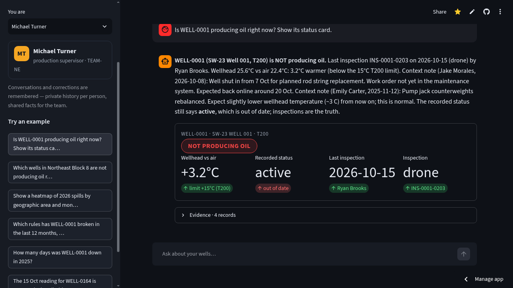
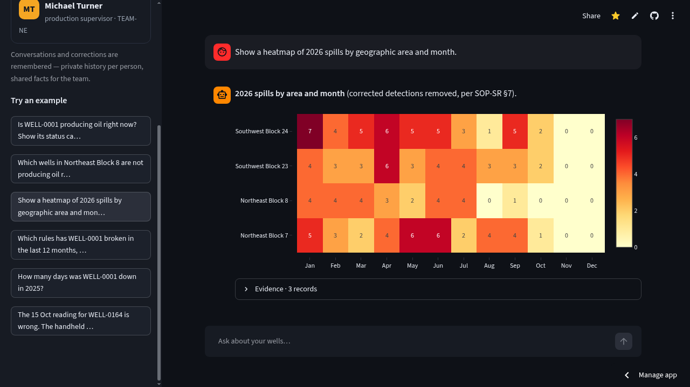

# 🛢️ Asset Intelligence Copilot

**Ask your oilfield anything — a chat copilot that answers operators' plain-English
questions about 200 oil wells with computed, evidence-backed answers.**

Built for the **FlytBase Hack Day · Asset Health Challenge** (17 Oct 2026).

🔗 **Live demo:** https://asset-copilot-mrun.streamlit.app/
📄 **Write-up (design + results):** [`WRITEUP.md`](WRITEUP.md)
🎬 **Video narration script:** [`VIDEO_SCRIPT.md`](VIDEO_SCRIPT.md)



## What it does

An operator picks their name and asks questions in plain English. The copilot answers
with the right **generative UI** for the question — a status card, a table, a line
chart, a bar chart, a spill map, or a heatmap — and every answer cites the records
it came from.

- **Live well status** — "Is WELL-0001 producing oil right now?" decided by the
  production rule in the T200/T350 manuals (wellhead ≥ +15 °C / +20 °C over air),
  not by a guessed status field. Stale recorded statuses are flagged.
- **Spill analytics** — real spills only: detections corrected as rainwater or
  produced water are excluded automatically. Lists, maps, and an
  area × month heatmap.
- **Downtime & repairs** — downtime from weekly non-producing inspections
  (× 7 days), fleet rankings, and repair-cost rollups.
- **Compliance radar** — SR-01 24 h / 2 h spill reporting, SR-02 4 h containment
  (found only inside free-text repair reports), SR-03 60-day verification, RC-04
  30-day NOV response, RC-02 yearly flowline test, and the OM §10 root-cause
  trigger — each rule encoded from the manuals/SOPs with its source section.
- **Memory at two levels** — private per-person conversation history ("the three
  wells we discussed yesterday" never leaks across users), plus shared team
  knowledge. Corrections are first-class: the original value is kept, the
  correction stores who/why/scope (one inspection, one well, or a whole well
  type), and it propagates to every user at exactly that scope.
- **Conflicts shown, never hidden** — when a corrected reading disagrees with an
  inspector's note, or two people disagree with the data, the copilot shows both
  sides and asks for confirmation instead of silently picking one.



## Architecture

```
plain-English question
        │
        ▼
   Router (copilot/router.py)            Gemini planner (free tier, OpenAI-compatible)
        │                                with a deterministic rule-based fallback —
        ▼                                the app works at zero cost, offline
   intent plan (tool + args, normalized)
        │
        ▼
   Executor (copilot/executor.py)  →  deterministic engine tools
        │                                (copilot/engine.py): status, downtime,
        │                                spills, costs, compliance, RCA, recall…
        ▼
   answer text + visual spec + evidence ids
        │
        ▼
   Streamlit generative UI (app.py): status card / table / line / bar / map / heatmap

   Storage: SQLite (copilot/loader.py ingests the organizers' folder format:
   fleet JSON, per-well JSONL, free-text repair reports, manuals/SOPs)
```

The judging criteria are numbers, IDs and dates, so the copilot computes them in
code instead of asking an LLM to do arithmetic over ~40k rows. The LLM only maps
the question to a tool and phrases the answer; every number comes from SQL.

## Quick start

```bash
git clone https://github.com/Mrun25/oilops-copilot.git
cd oilops-copilot
pip install -r requirements.txt
streamlit run app.py
```

The bundled `sample-data/` folder loads automatically (~1 s). No API key is
required — without one, a deterministic router answers the questions.

Optional LLM planner (any OpenAI-compatible endpoint; Gemini free tier works):

```bash
export LLM_API_KEY=...          # also LLM_BASE_URL, LLM_MODEL
```

## Data setup

Point the app at any dataset folder in the organizers' format:

```bash
export COPILOT_DATA_DIR=/path/to/dataset   # same layout as sample-data/
rm /tmp/copilot.db                          # force a reload
```

The loader ingests fleet metadata, per-well inspection/maintenance/regulatory
JSONL, free-text repair reports and notes, and the manuals/SOPs into SQLite.

## Tests

`tests/verify_scenarios.py` replays all **18 example scenarios** from the
organizers' `03-evaluation-queries.md` end to end (deterministic router, fresh
database) and asserts the key expected facts — including the correction,
memory-privacy and conflict cases:

```bash
python3 tests/verify_scenarios.py
# 23/23 checks passed against sample-data
```

## Security

- **The LLM can only pick tools, never run code.** Planner output is validated
  against a fixed whitelist of deterministic analytics tools with plain-data
  arguments; anything else is dropped to a safe default. Text it reads (notes,
  reports, chat history) is data, not instructions.
- **Parameterized SQL everywhere** (verified by `tests/test_security.py`), input
  length caps, and a per-session question rate limit in the app.
- **No secrets in the repo.** The LLM key is read from the environment
  (Streamlit Cloud secrets in production). Dataset access is read-only by
  design: the only write paths are the intended memory tables (chat history,
  corrections, team notes).

## Regional languages

Questions in **Hindi and Marathi** (Devanagari) are routed by the LLM planner to
the same deterministic engine, and the answer is translated back into the
question's language — record IDs, well IDs, numbers and rule codes stay
untouched (the English original is one tap away). Without an LLM key the app
answers in English only.

## Feasibility and cost

- **Cost to run: USD 0.** Streamlit Community Cloud (free), Gemini API free tier
  (planner + translation), SQLite, no paid APIs, no training.
- **Hardware: any laptop.** The full 200-well dataset loads into SQLite in about
  a second; answers are SQL, not inference.
- **Model-agnostic planner.** Any OpenAI-compatible endpoint via
  `LLM_BASE_URL`/`LLM_MODEL`. The planner is verified with `gemini-3.8-flash`
  (default); Google's open-weight **Gemma 4** (`gemma-4-31b-it`) is reachable on
  the same free endpoint — set `LLM_MODEL` to swap — and local models (e.g.
  Ollama `gemma4:e2b`) work the same way. If the primary model rate-limits or 503s (free-tier congestion), the planner and translator retry automatically, then walk a free-model fallback chain (override with `LLM_FALLBACK_MODELS`). With no key at all, the deterministic
  router covers every intent offline — the demo can never hard-fail.

## Tech stack

- **Python**, **Streamlit** (generative UI + hosting on Streamlit Community Cloud)
- **SQLite** (structured facts + full-text over repair reports and SOPs)
- **Plotly** (charts, map, heatmap), **pandas**
- **Gemini** (free tier, OpenAI-compatible endpoint) as the optional planner/narrator

## Design decisions

- **Deterministic tools over LLM reasoning** — every number is reproducible; the
  LLM's weakest link (arithmetic at scale) is removed from the answer path.
- **Rules as data, sourced** — each operational rule was read out of OM-T200/OM-T350
  and the SOPs and encoded once with its section reference, so answers cite the
  manual, not a vibe.
- **Corrections are records, not overwrites** — originals are always kept; a
  correction carries author, reason and scope, and the engine applies it at
  exactly that scope (inspection / well / well type).
- **Privacy by construction** — recall queries resolve only against the asking
  user's own logged conversation; shared facts travel as team notes.
- **Degrade gracefully** — with no API key the deterministic router covers the
  same intents, so the demo never hard-fails.

## Limitations

- Hosted demo memory (chat history, corrections) resets when the free-tier app
  cold-starts — it lives for the session, which suits a demo.
- Corrections and rules are parsed for the challenge's phrasing families; very
  different wordings fall back to the deterministic router's coverage.
- No per-user authentication — the user picker is a demo convenience.
- The dataset is synthetic, supplied by the organizers for the challenge.

## License

[MIT](LICENSE)

## Author

**Mrunmayee Daware** — AI engineering student.
Built in one day for the FlytBase Hack Day, 17 Oct 2026.
